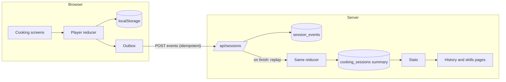

# Cookbook

Recipes you play, one step at a time.

**Try it live: [cookbook-eight-jet.vercel.app](https://cookbook-eight-jet.vercel.app)**. You can cook as a guest, no sign-up needed.

Cooking mode puts a single step on screen with an animation that shows the motion, the heat and what "done" looks like. Timers keep running in a dock while you move on to the next step. Every cook is recorded as a log of events, and the skills page is computed from what you actually cooked.

## What it does

- **Cooking mode.** A mise en place checklist, then one step per screen: the animated scene, the amounts that step uses, a doneness cue and a timer. Tap the right side of the scene for next, the left for back, or use the arrow keys. The screen stays awake, and a finished timer chimes and vibrates.
- **Animated scenes for any recipe.** Each step has a technique (chop, whisk, sauté, simmer, roast and fifteen more). The technique picks one of six hand-drawn SVG stations: board, bowl, pan, pot, oven or plate. Ingredients are drawn from the recipe's own data, so a recipe someone types in is animated without any extra work.
- **Timers that overlap.** A timer stores the time it ends, so it survives a reload or a sleeping phone. Background timers move to a dock and keep counting across steps.
- **Import.** Paste a recipe as text or give a link to a page with schema.org recipe data. The importer works out ingredients, techniques, heat, timers and doneness cues, then opens the result in an editor with a live preview of each step's animation.
- **History and skills.** Finished cooks appear in your history with a step-by-step timeline. The skills page shows which techniques you have practised, cuisine proficiency, a weekly streak and recipes that would teach you something new.
- **Accounts.** You can cook as a guest. Signing up moves the guest's history, recipes and favourites to the new account.

## How it works



- **One reducer, two places.** `src/lib/player` is a pure function, `(state, event) => state`, with no clock and no I/O. The browser runs it live. When a session finishes, the server replays the stored events through the same code and writes the summary itself, so it never trusts totals sent by the client.
- **Events are append-only.** Each event gets its id in the browser. Sending a batch twice inserts nothing new, so retries after a dropped connection are safe. A reload replays the events and puts you back on the same step with the timers intact.
- **History does not change.** A session stores a snapshot of the recipe it was cooked from, so editing or deleting a recipe later leaves past cooks as they were.
- **Skills are derived.** A session only counts if it took a plausible share of the recipe's timer time, so tapping through a recipe earns nothing.

| Path | What is there |
|---|---|
| `src/lib/player` | Event types, reducer, commands, selectors |
| `src/components/stage` | The animated stations and ingredient tokens |
| `src/components/cook` | Cooking mode screens and the session hook |
| `src/lib/import` | Text and schema.org parsing into structured steps |
| `src/lib/sessions`, `src/lib/stats` | Event ingestion, replay, and the numbers on the skills page |
| `src/lib/db` | Recipe queries and the mapping between rows and app types |
| `src/lib/auth` | Better Auth setup, guest users and account hand-over |
| `prisma` | Schema, migrations and seed |
| `scripts` | Bulk import of a site's recipes into a local database |

## Running it locally

You need Node 22 and Postgres 16. `docker compose up -d` starts a Postgres if you don't have one.

```bash
npm install
cp .env.example .env.local      # then set DATABASE_URL and BETTER_AUTH_SECRET
npx prisma migrate deploy
npx prisma db seed
npm run dev
```

Open http://localhost:3000. The seed adds eleven public recipes and a demo account; its email and development password are constants at the top of `prisma/seed.ts`.

`/stage-lab` shows every animated scene at each stage of progress.

| Command | What it does |
|---|---|
| `npm run dev` | Development server |
| `npm test` | Unit and integration tests (integration tests use a `cookbook_test` database and skip if it is unreachable) |
| `npm run e2e` | End-to-end tests in your installed Chrome, against a production build and the local database |
| `npm run typecheck` | TypeScript |
| `npm run lint` | ESLint |
| `npm run build` | Production build |

If the development server crashes with "Next.js package not found", delete the `.next` folder and start it again.

## Deploying

The app runs on Vercel with a Neon Postgres database.

```bash
npx vercel deploy --prod                              # build and release
DATABASE_URL="<direct Neon URL>" npx prisma migrate deploy   # after a schema change
```

Vercel holds two production variables: `DATABASE_URL` (Neon's pooled connection string) and `BETTER_AUTH_SECRET`. The site address comes from Vercel, so `BETTER_AUTH_URL` is only needed locally. Run migrations against Neon's direct connection string, which is the pooled one without `-pooler` in the host. The seed skips the demo account on any database that is not local.

## Ingredient drawings

Food on the cutting board is drawn by mise, a separate ingredient-drawing library in `../mise`. It isn't published yet, and Vercel builds from this folder alone, so its source is copied into `src/vendor/mise`. After changing mise, copy it again:

```bash
node scripts/sync-mise.mjs
```

`src/vendor/mise/VERSION.md` records which mise commit the copy came from. Don't edit the copy; change mise and sync.

## Stack

Next.js 16 (App Router), React 19, TypeScript, Tailwind 4, Motion, Prisma 6, Postgres, Better Auth, Zod, Vitest.

## Recipe credits

Eight of the seeded recipes are adapted from [Made With Lau](https://www.madewithlau.com/), with quantities from the originals and steps rewritten for the player. Each one links to its source page. Imported recipes are private to the account that imported them.

## Plan

`PLAN.md` has the design reasoning and the milestone list.
